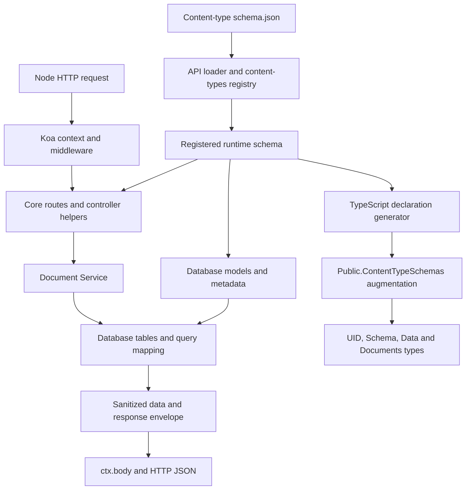

A content-type schema feeds two different systems: **runtime metadata** and
**compile-time TypeScript declarations**. Runtime metadata drives database
mapping, validation, sanitization, and route construction. Generated
declarations drive editor and compiler inference. The declarations do not
execute in Koa and do not validate an HTTP payload.

This page follows an application collection type with UID
`api::article.article`, the default core factories, and `GET /api/articles`. It
also identifies the write-path differences. Custom controllers, routes, and
Document Service middleware can change the execution path. This is the REST
Content API path, not the admin Content Manager or GraphQL path.

## Three paths, not one type pipeline



The arrows into TypeScript inference describe compile-time dependencies. They
are not runtime calls. Route registration and request execution happen at
different times. A schema alone does not install an endpoint: the application's
router and controller modules select the core factories.

## 1. Load JSON and register a runtime content type

The source schema normally lives at
`src/api/article/content-types/article/schema.json`. The runtime API loader
reads `strapi.dirs.dist.api`; in a compiled TypeScript application this is the
compiled application tree. Do not confuse the schema source with the directory
the running loader reads.

| Step | Call or operation                                                                                               | Value crossing the boundary                                                                                                                                                     | Source                                                                                                                                                                                                                                                                                                                                                    |
| ---- | --------------------------------------------------------------------------------------------------------------- | ------------------------------------------------------------------------------------------------------------------------------------------------------------------------------- | --------------------------------------------------------------------------------------------------------------------------------------------------------------------------------------------------------------------------------------------------------------------------------------------------------------------------------------------------------- |
| 1    | `Strapi.start()` to `load()` to `register()`, then `bootstrap()`                                                | The Strapi instance owns the registries and services.                                                                                                                           | [Strapi.ts](https://github.com/strapi/strapi/blob/develop/packages/core/core/src/Strapi.ts)                                                                                                                                                                                                                                                               |
| 2    | The registries provider calls `loadApplicationContext()`.                                                       | API, plugin, component, middleware, and policy loading starts concurrently. There is no guaranteed API-versus-plugin loader order.                                              | [providers/registries.ts](https://github.com/strapi/strapi/blob/develop/packages/core/core/src/providers/registries.ts), [loaders/index.ts](https://github.com/strapi/strapi/blob/develop/packages/core/core/src/loaders/index.ts)                                                                                                                        |
| 3    | `loadAPIs()` to `loadAPI()` to `loadContentTypes()` to `loadDir()` to `loadFile()` to `fse.readJSON()`          | `schema.json` becomes the `schema` property of a content-type definition. Other files supply actions and lifecycles.                                                            | [loaders/apis.ts](https://github.com/strapi/strapi/blob/develop/packages/core/core/src/loaders/apis.ts)                                                                                                                                                                                                                                                   |
| 4    | `loadContentTypes()` enriches the definition; `loadAPIs()` checks name uniqueness.                              | Adds `schema.apiName`, a missing `collectionName`, and `globalId`. The content-type directory name becomes the definition key.                                                  | [loaders/apis.ts](https://github.com/strapi/strapi/blob/develop/packages/core/core/src/loaders/apis.ts)                                                                                                                                                                                                                                                   |
| 5    | `apis.add(apiName, rawAPI)` to `modules.add(namespace, rawAPI)` to module `load()`                              | The module namespace is `api::article`; module loading installs its content types, controllers, services, and other artifacts in registries.                                    | [registries/apis.ts](https://github.com/strapi/strapi/blob/develop/packages/core/core/src/registries/apis.ts), [registries/modules.ts](https://github.com/strapi/strapi/blob/develop/packages/core/core/src/registries/modules.ts), [domain/module/index.ts](https://github.com/strapi/strapi/blob/develop/packages/core/core/src/domain/module/index.ts) |
| 6    | `content-types.add(namespace, definitions)` to `createContentType(uid, definition)`                             | The registry checks the definition key against `info.singularName`, rejects duplicate UIDs, and assigns `api::article.article`. The UID need not appear in the JSON.            | [registries/content-types.ts](https://github.com/strapi/strapi/blob/develop/packages/core/core/src/registries/content-types.ts), [domain/content-type/index.ts](https://github.com/strapi/strapi/blob/develop/packages/core/core/src/domain/content-type/index.ts)                                                                                        |
| 7    | `createContentType()` validates and deep-clones the definition.                                                 | Produces a runtime schema with `uid`, `modelType: 'contentType'`, `modelName`, a default collection kind, actions, lifecycles, and an original-schema snapshot in `__schema__`. | [domain/content-type/index.ts](https://github.com/strapi/strapi/blob/develop/packages/core/core/src/domain/content-type/index.ts)                                                                                                                                                                                                                         |
| 8    | Providers finish registering; module and application `register` callbacks run; `convertCustomFieldType()` runs. | Plugins and application code can alter the registered schemas before database initialization. Custom-field attributes become their registered underlying types.                 | [Strapi.ts](https://github.com/strapi/strapi/blob/develop/packages/core/core/src/Strapi.ts), [convert-custom-field-type.ts](https://github.com/strapi/strapi/blob/develop/packages/core/core/src/utils/convert-custom-field-type.ts)                                                                                                                      |

The runtime schema is richer than the JSON. `createContentType()` injects
`createdAt`, `updatedAt`, `publishedAt`, and the `createdBy`/`updatedBy`
admin-user relations. `publishedAt` is added even when draft-and-publish is
disabled; a missing `options.draftAndPublish` defaults to false.
`firstPublishedAt` is conditional. The
[i18n registration code](https://github.com/strapi/strapi/blob/develop/packages/plugins/i18n/server/src/register.ts)
also adds `locale` and virtual `localizations` attributes. These changes explain
why downstream declarations or metadata contain fields absent from the source
JSON.

### Runtime schema to database model

This branch is needed to understand the values a controller later receives. It
does not replace the content-types registry.

| Step | Call or operation                                                                                                 | Transformation                                                                                                                                                              | Source                                                                                                                                                                                                                                               |
| ---- | ----------------------------------------------------------------------------------------------------------------- | --------------------------------------------------------------------------------------------------------------------------------------------------------------------------- | ---------------------------------------------------------------------------------------------------------------------------------------------------------------------------------------------------------------------------------------------------- |
| 9    | `Strapi.bootstrap()` to `transformContentTypesToModels()`                                                         | Registered content types and components become database `Model[]`; additional registered database models are appended.                                                      | [Strapi.ts](https://github.com/strapi/strapi/blob/develop/packages/core/core/src/Strapi.ts), [transform-content-types-to-models.ts](https://github.com/strapi/strapi/blob/develop/packages/core/core/src/utils/transform-content-types-to-models.ts) |
| 10   | Model conversion adds database-facing fields and relations.                                                       | Adds an incrementing `id`; content types also receive `documentId`. Media, components, and dynamic zones become database relations. Component-link models can be generated. | [transform-content-types-to-models.ts](https://github.com/strapi/strapi/blob/develop/packages/core/core/src/utils/transform-content-types-to-models.ts)                                                                                              |
| 11   | `db.init({ models })` to `metadata.loadModels(models)`                                                            | Models become metadata: table names, scalar column names, relation/join metadata, and column-to-attribute maps. Virtual attributes are excluded from physical processing.   | [database/index.ts](https://github.com/strapi/strapi/blob/develop/packages/core/database/src/index.ts), [metadata/metadata.ts](https://github.com/strapi/strapi/blob/develop/packages/core/database/src/metadata/metadata.ts)                        |
| 12   | `db.schema.sync()` uses the schema provider and `metadataToSchema()`.                                             | Metadata supplies the physical schema used for migration/diff and synchronization.                                                                                          | [schema/index.ts](https://github.com/strapi/strapi/blob/develop/packages/core/database/src/schema/index.ts)                                                                                                                                          |
| 13   | Bootstrap finishes schema sync and persistence, then calls `server.initMiddlewares()` and `server.initRouting()`. | Routes see registered runtime schemas after database setup. Module bootstrap callbacks run later.                                                                           | [Strapi.ts](https://github.com/strapi/strapi/blob/develop/packages/core/core/src/Strapi.ts)                                                                                                                                                          |

For the database branch in more detail, see [Schema sync](./07-schema-sync.md).
It explains synchronization rather than TypeScript inference.

## 2. Generate TypeScript declarations

Both entry points generate from a **loaded Strapi registry**, not directly from
JSON.

| Step | Call or type operation                                                                                                                              | Result                                                                                                                                                                                                                                                                | Source                                                                                                                                                                                                                                                                                                                                                                                                        |
| ---- | --------------------------------------------------------------------------------------------------------------------------------------------------- | --------------------------------------------------------------------------------------------------------------------------------------------------------------------------------------------------------------------------------------------------------------------- | ------------------------------------------------------------------------------------------------------------------------------------------------------------------------------------------------------------------------------------------------------------------------------------------------------------------------------------------------------------------------------------------------------------- |
| 1a   | CLI `ts:generate-types` to `compileStrapi({ ignoreDiagnostics: true })` to `createStrapi(appContext).register()` to `tsUtils.generators.generate()` | Registers the app without a full database bootstrap, enables content-type and component artifacts, then destroys the app.                                                                                                                                             | [ts/generate-types.ts](https://github.com/strapi/strapi/blob/develop/packages/core/strapi/src/cli/commands/ts/generate-types.ts)                                                                                                                                                                                                                                                                              |
| 1b   | Development worker to `strapi.load()` to generation to subsequent TypeScript compilation and server start                                           | TypeScript projects generate declarations regardless of `typescript.autogenerate`. Other projects generate unless that option is false. Unlike the explicit command, this path has already bootstrapped the app.                                                      | [node/develop.ts](https://github.com/strapi/strapi/blob/develop/packages/core/strapi/src/node/develop.ts)                                                                                                                                                                                                                                                                                                     |
| 2    | `generate()` selects enabled entries in `GENERATORS`.                                                                                               | The default root is `types`; the generator appends `generated`. The content-type artifact becomes `types/generated/contentTypes.d.ts`. CLI `--out-dir` overrides the root, not the final filename.                                                                    | [generators/index.ts](https://github.com/strapi/strapi/blob/develop/packages/utils/typescript/src/generators/index.ts), [constants.ts](https://github.com/strapi/strapi/blob/develop/packages/utils/typescript/src/generators/constants.ts)                                                                                                                                                                   |
| 3    | `generateContentTypesDefinitions()` sorts `Object.values(strapi.contentTypes)` and calls schema-definition generation.                              | Each registered schema becomes an interface. UID `api::article.article` becomes interface name `ApiArticleArticle`; model type and kind select `Struct.CollectionTypeSchema`.                                                                                         | [content-types/index.ts](https://github.com/strapi/strapi/blob/develop/packages/utils/typescript/src/generators/content-types/index.ts), [models/schema.ts](https://github.com/strapi/strapi/blob/develop/packages/utils/typescript/src/generators/common/models/schema.ts), [models/utils.ts](https://github.com/strapi/strapi/blob/develop/packages/utils/typescript/src/generators/common/models/utils.ts) |
| 4    | Attribute generation maps each attribute and intersects its modifiers.                                                                              | A required string becomes `Schema.Attribute.String & Schema.Attribute.Required`. Relations retain target UIDs; components retain UID and repeatability; dynamic zones retain component UID tuples. Private, unique, default, and other options become type modifiers. | [models/attributes.ts](https://github.com/strapi/strapi/blob/develop/packages/utils/typescript/src/generators/common/models/attributes.ts), [models/mappers.ts](https://github.com/strapi/strapi/blob/develop/packages/utils/typescript/src/generators/common/models/mappers.ts)                                                                                                                              |
| 5    | `generateSharedExtensionDefinition()` to `emitDefinitions()` to formatting to `saveDefinitionToFileSystem()`                                        | Emits imports, interfaces, and module augmentation, then writes the artifact. Component generation supplies the parallel component registry.                                                                                                                          | [generators/utils.ts](https://github.com/strapi/strapi/blob/develop/packages/utils/typescript/src/generators/utils.ts), [generators/index.ts](https://github.com/strapi/strapi/blob/develop/packages/utils/typescript/src/generators/index.ts)                                                                                                                                                                |

For a minimal illustrative schema attribute
`"title": { "type": "string", "required": true }`, the relevant generated pieces
are:

```ts
import type { Schema, Struct } from "@strapi/strapi";

export interface ApiArticleArticle extends Struct.CollectionTypeSchema {
  // Other generated schema members and injected attributes omitted here.
  attributes: {
    title: Schema.Attribute.String & Schema.Attribute.Required;
  };
}

declare module "@strapi/strapi" {
  export namespace Public {
    export interface ContentTypeSchemas {
      "api::article.article": ApiArticleArticle;
    }
  }
}
```

This is an excerpt, not a complete generated file. A checked-in example is the
website template's
[page schema](https://github.com/strapi/strapi/blob/develop/templates/website/src/api/page/content-types/page/schema.json)
and
[generated declarations](https://github.com/strapi/strapi/blob/develop/templates/website/types/generated/contentTypes.d.ts).
`ApiPagePage` maps `metadata` to a required nonrepeatable component and
`contentSections` to a dynamic zone. The generated file includes injected fields
that the JSON does not declare.

### How those declarations become values and method signatures

These are type-level operations, not function calls.

| Boundary                        | Type operation and guarantee                                                                                                                                                                                                                                                                                | Source                                                                                                                                                                                                                                                                                                                                                                                                     |
| ------------------------------- | ----------------------------------------------------------------------------------------------------------------------------------------------------------------------------------------------------------------------------------------------------------------------------------------------------------- | ---------------------------------------------------------------------------------------------------------------------------------------------------------------------------------------------------------------------------------------------------------------------------------------------------------------------------------------------------------------------------------------------------------- |
| Augmentation to registry        | `Public.ContentTypeSchemas` gains concrete UID-to-interface entries. The generated declarations must be included in the application's TypeScript program for augmentation to apply.                                                                                                                         | [public/registries.ts](https://github.com/strapi/strapi/blob/develop/packages/core/types/src/public/registries.ts), [website tsconfig.json](https://github.com/strapi/strapi/blob/develop/templates/website/tsconfig.json)                                                                                                                                                                                 |
| Registry to UID                 | `UID.ContentType` derives content-type keys; collection/single UID types select schemas by kind.                                                                                                                                                                                                            | [uid/index.ts](https://github.com/strapi/strapi/blob/develop/packages/core/types/src/uid/index.ts), [internal/registry.ts](https://github.com/strapi/strapi/blob/develop/packages/core/types/src/internal/registry.ts)                                                                                                                                                                                     |
| UID to schema                   | `Schema.ContentType<TUID>` indexes the registry. `Schema.Attributes<TUID>` and attribute-name lookups expose the registered definitions.                                                                                                                                                                    | [schema/index.ts](https://github.com/strapi/strapi/blob/develop/packages/core/types/src/schema/index.ts)                                                                                                                                                                                                                                                                                                   |
| Attribute definition to value   | `Schema.Attribute.Value<T>` dispatches by attribute type. `Schema.Attribute.String` is a descriptor; its value type is `string`, not the descriptor itself.                                                                                                                                                 | [attribute/utils.ts](https://github.com/strapi/strapi/blob/develop/packages/core/types/src/schema/attribute/utils.ts), [definitions/string.ts](https://github.com/strapi/strapi/blob/develop/packages/core/types/src/schema/attribute/definitions/string.ts)                                                                                                                                               |
| Schema to data shape            | `Data.ContentType<TUID, Keys>` combines `id` and `documentId` with selected attribute values. Its attribute properties are optional and nullable; a required schema descriptor does not make every output property unconditionally present.                                                                 | [data/content-type.ts](https://github.com/strapi/strapi/blob/develop/packages/core/types/src/data/content-type.ts)                                                                                                                                                                                                                                                                                         |
| Literal UID to Document Service | `strapi.documents(uid)` selects `ServiceInstance<TUID>`. Method parameter types constrain fields, filters, populate, and mutation data using that UID.                                                                                                                                                      | [documents/index.ts](https://github.com/strapi/strapi/blob/develop/packages/core/types/src/modules/documents/index.ts), [service-instance.ts](https://github.com/strapi/strapi/blob/develop/packages/core/types/src/modules/documents/service-instance.ts), [params/document-engine.ts](https://github.com/strapi/strapi/blob/develop/packages/core/types/src/modules/documents/params/document-engine.ts) |
| Mutation attributes to input    | `Input<TUID>` distinguishes required and optional attributes and computes component/dynamic-zone inputs. Update uses partial data. The outer `data` parameter is optional in the parameter utility even for create, so runtime validation remains necessary.                                                | [params/data.ts](https://github.com/strapi/strapi/blob/develop/packages/core/types/src/modules/documents/params/data.ts), [params/index.ts](https://github.com/strapi/strapi/blob/develop/packages/core/types/src/modules/documents/params/index.ts)                                                                                                                                                       |
| UID and query to result         | Result utilities account for fields/populate selections. Without extended schema registries, the result falls back to `AnyDocument`.                                                                                                                                                                        | [result/index.ts](https://github.com/strapi/strapi/blob/develop/packages/core/types/src/modules/documents/result/index.ts), [result/document-engine.ts](https://github.com/strapi/strapi/blob/develop/packages/core/types/src/modules/documents/result/document-engine.ts)                                                                                                                                 |
| Core service/controller to Koa  | Core service mutation data is broad `Record<string, unknown>` and results use `Documents.AnyDocument`. Core controller actions use `ControllerHandler<unknown>`, ordinary Koa `Context`, and sanitizers returning `unknown`. The literal UID is not preserved end-to-end through these default HTTP layers. | [core-api/service.ts](https://github.com/strapi/strapi/blob/develop/packages/core/types/src/core/core-api/service.ts), [core-api/controller.ts](https://github.com/strapi/strapi/blob/develop/packages/core/types/src/core/core-api/controller.ts), [controller.ts](https://github.com/strapi/strapi/blob/develop/packages/core/types/src/core/controller.ts)                                              |

For example, TypeScript can use `'api::article.article'` in `strapi.documents()`
to check field names and infer selected results. That does not change the type
of `ctx.query` or prove that an HTTP client sent a valid article. The generated
declaration file is compile-time input and supplies no runtime validator.

## 3. Turn the runtime schema into a mounted Koa endpoint

These are boot-time calls. The default application route module calls
`factories.createCoreRouter('api::article.article')`; its controller and service
modules select the corresponding core factories.

| Step | Call or operation                                                                                                              | Schema/type information used                                                                                                                                                                                     | Source                                                                                                                                                                                                                                                                                                                                                                                                                                                        |
| ---- | ------------------------------------------------------------------------------------------------------------------------------ | ---------------------------------------------------------------------------------------------------------------------------------------------------------------------------------------------------------------- | ------------------------------------------------------------------------------------------------------------------------------------------------------------------------------------------------------------------------------------------------------------------------------------------------------------------------------------------------------------------------------------------------------------------------------------------------------------- |
| 1    | `createCoreRouter(uid, cfg)` returns a router with a lazy `routes` getter.                                                     | The UID identifies a registered content type. Config can select or exclude actions and set a prefix. No routes are materialized yet.                                                                             | [factories.ts](https://github.com/strapi/strapi/blob/develop/packages/core/core/src/factories.ts)                                                                                                                                                                                                                                                                                                                                                             |
| 2    | `server.initRouting()` to `registerAllRoutes()` to `registerAPIRoutes()`                                                       | API router callbacks are instantiated; reading `router.routes` triggers the lazy getter. API routes are tagged `content-api`.                                                                                    | [register-routes.ts](https://github.com/strapi/strapi/blob/develop/packages/core/core/src/services/server/register-routes.ts)                                                                                                                                                                                                                                                                                                                                 |
| 3    | Getter to `strapi.contentType(uid)` to `createRoutes({ contentType, strapi })`                                                 | `kind` selects collection versus single type. A collection uses `info.pluralName`; a single type uses `info.singularName`. The UID builds handler strings.                                                       | [factories.ts](https://github.com/strapi/strapi/blob/develop/packages/core/core/src/factories.ts), [core-api/routes/index.ts](https://github.com/strapi/strapi/blob/develop/packages/core/core/src/core-api/routes/index.ts)                                                                                                                                                                                                                                  |
| 4    | `getCollectionTypeRoutes()` constructs `CoreContentTypeRouteValidator`.                                                        | The `find` route is `GET /articles` with handler `api::article.article.find`. Runtime attributes supply query/body/document Zod contracts. Locale and publication query contracts depend on schema capabilities. | [core-api/routes/index.ts](https://github.com/strapi/strapi/blob/develop/packages/core/core/src/core-api/routes/index.ts), [validation/content-type.ts](https://github.com/strapi/strapi/blob/develop/packages/core/core/src/core-api/routes/validation/content-type.ts)                                                                                                                                                                                      |
| 5    | `registerAPIRoutes()` adds auth scope and API information, applies extra parameters, and calls `strapi.server.routes(router)`. | The string handler supplies the default auth scope. Extra registered parameters are merged into route contracts.                                                                                                 | [register-routes.ts](https://github.com/strapi/strapi/blob/develop/packages/core/core/src/services/server/register-routes.ts)                                                                                                                                                                                                                                                                                                                                 |
| 6    | Server `routes()` to content API `routes()` to `routeManager.addRoutes()` to `createRoute()`                                   | The Content API router supplies the configured REST prefix, default `/api`. Route configuration is checked and `info.type` is attached.                                                                          | [server/index.ts](https://github.com/strapi/strapi/blob/develop/packages/core/core/src/services/server/index.ts), [content-api.ts](https://github.com/strapi/strapi/blob/develop/packages/core/core/src/services/server/content-api.ts), [api.ts](https://github.com/strapi/strapi/blob/develop/packages/core/core/src/services/server/api.ts), [routing.ts](https://github.com/strapi/strapi/blob/develop/packages/core/core/src/services/server/routing.ts) |
| 7    | Endpoint composer to `getAction()` to `getController()` to controller registry                                                 | The handler string is split into controller and action. The resolved action is bound to its controller. Policies and route middleware are resolved at registration time.                                         | [compose-endpoint.ts](https://github.com/strapi/strapi/blob/develop/packages/core/core/src/services/server/compose-endpoint.ts)                                                                                                                                                                                                                                                                                                                               |
| 8    | The controller factory calls `createController({ contentType: strapi.contentType(uid) })`.                                     | Runtime `kind` chooses the core collection/single controller. Its helpers retain the runtime schema for validation, sanitization, and response transformation. Custom methods override base methods.             | [factories.ts](https://github.com/strapi/strapi/blob/develop/packages/core/core/src/factories.ts), [controller/index.ts](https://github.com/strapi/strapi/blob/develop/packages/core/core/src/core-api/controller/index.ts)                                                                                                                                                                                                                                   |
| 9    | Endpoint composer calls `router[method](path, composedHandler)`.                                                               | The composition stores route info, authentication, authorization, policies, middleware, return-body handling, and the bound action.                                                                              | [compose-endpoint.ts](https://github.com/strapi/strapi/blob/develop/packages/core/core/src/services/server/compose-endpoint.ts)                                                                                                                                                                                                                                                                                                                               |
| 10   | Server `listen()` to `mount()` to API `mount(rootRouter)` to `app.use(rootRouter.routes()).use(rootRouter.allowedMethods())`   | Registers the middleware stack used by Koa. The endpoint is now reachable at `/api/articles` with the default prefix.                                                                                            | [server/index.ts](https://github.com/strapi/strapi/blob/develop/packages/core/core/src/services/server/index.ts), [api.ts](https://github.com/strapi/strapi/blob/develop/packages/core/core/src/services/server/api.ts)                                                                                                                                                                                                                                       |

The route's Zod contracts and the generated `.d.ts` files are separate products
of runtime schemas. The endpoint composer does not automatically parse an entire
request or response against those Zod contracts. Do not read `route.response` as
a guarantee that every outgoing payload is checked. Core controller helpers
perform the request-path validation and sanitization described below.

## 4. Follow one HTTP request, call by call

The table follows a successful core collection `find`. Authentication,
authorization, policies, and validation can stop execution before the database
call.

| Step | Call                                                                                                                                                                  | Value/type boundary                                                                                                                                                                       | Source                                                                                                                                                                                                                                                                                                                                                                                        |
| ---- | --------------------------------------------------------------------------------------------------------------------------------------------------------------------- | ----------------------------------------------------------------------------------------------------------------------------------------------------------------------------------------- | --------------------------------------------------------------------------------------------------------------------------------------------------------------------------------------------------------------------------------------------------------------------------------------------------------------------------------------------------------------------------------------------- |
| 1    | Node HTTP server invokes `handleRequest(req, res)`.                                                                                                                   | `req` and `res` are Node HTTP objects, not generated article types.                                                                                                                       | [http-server.ts](https://github.com/strapi/strapi/blob/develop/packages/core/core/src/services/server/http-server.ts)                                                                                                                                                                                                                                                                         |
| 2    | On the first request, `handleRequest()` caches `koaApp.callback()`; then calls `handler(req, res)`.                                                                   | Koa owns context creation and middleware execution from this boundary. The callback is created lazily so it includes mounted middleware.                                                  | [http-server.ts](https://github.com/strapi/strapi/blob/develop/packages/core/core/src/services/server/http-server.ts)                                                                                                                                                                                                                                                                         |
| 3    | Request-context middleware calls `requestCtx.run(ctx, () => next())`; global middleware and router dispatch follow.                                                   | Koa `ctx` holds request state. Query/body parsing produces runtime values, not trusted schema-derived TypeScript input.                                                                   | [server/index.ts](https://github.com/strapi/strapi/blob/develop/packages/core/core/src/services/server/index.ts)                                                                                                                                                                                                                                                                              |
| 4    | `createRouteInfoMiddleware()` to authentication to authorization to policies to route middleware                                                                      | Sets `ctx.state.route`; authentication can populate `ctx.state.auth`; authorization verifies it. No article-shaped Koa context is constructed.                                            | [compose-endpoint.ts](https://github.com/strapi/strapi/blob/develop/packages/core/core/src/services/server/compose-endpoint.ts)                                                                                                                                                                                                                                                               |
| 5    | `returnBodyMiddleware()` awaits the bound `find(ctx)` action.                                                                                                         | `Core.ControllerHandler` accepts ordinary Koa `Context` and `Next`. Core collection actions return `unknown` at the public type boundary.                                                 | [compose-endpoint.ts](https://github.com/strapi/strapi/blob/develop/packages/core/core/src/services/server/compose-endpoint.ts), [types/core/controller.ts](https://github.com/strapi/strapi/blob/develop/packages/core/types/src/core/controller.ts), [types/core/core-api/controller.ts](https://github.com/strapi/strapi/blob/develop/packages/core/types/src/core/core-api/controller.ts) |
| 6    | Collection `find()` to `this.validateQuery(ctx)` to `this.sanitizeQuery(ctx)`                                                                                         | Helpers call `strapi.contentAPI.validate.query` and `sanitize.query` with the captured runtime content type and auth/route/strict-parameter options. Sanitization returns a query object. | [controller/collection-type.ts](https://github.com/strapi/strapi/blob/develop/packages/core/core/src/core-api/controller/collection-type.ts), [controller/index.ts](https://github.com/strapi/strapi/blob/develop/packages/core/core/src/core-api/controller/index.ts)                                                                                                                        |
| 7    | `strapi.service(uid).find(sanitizedQuery)` to `CollectionTypeService.find()`                                                                                          | The service factory builds a service for the registered schema. `getFetchParams()` defaults to `status: 'published'`, unless params override it; pagination is normalized.                | [factories.ts](https://github.com/strapi/strapi/blob/develop/packages/core/core/src/factories.ts), [service/collection-type.ts](https://github.com/strapi/strapi/blob/develop/packages/core/core/src/core-api/service/collection-type.ts), [core-service.ts](https://github.com/strapi/strapi/blob/develop/packages/core/core/src/core-api/service/core-service.ts)                           |
| 8    | `strapi.documents(uid).findMany(fetchParams)`                                                                                                                         | The Document Service caches a repository per UID and wraps repository methods with document middleware. That middleware receives `{ uid, contentType, action, params }`, not Koa `ctx`.   | [document-service/index.ts](https://github.com/strapi/strapi/blob/develop/packages/core/core/src/services/document-service/index.ts), [middleware-manager.ts](https://github.com/strapi/strapi/blob/develop/packages/core/core/src/services/document-service/middlewares/middleware-manager.ts)                                                                                               |
| 9    | Repository `findMany()` to `validateParams` to draft/publication transforms to locale transforms to `transformParamsDocumentId(uid)` to `transformParamsToQuery(uid)` | Document parameters become a database query. The repository defaults to draft only when status was not already supplied; the core REST service normally supplied published.               | [repository.ts](https://github.com/strapi/strapi/blob/develop/packages/core/core/src/services/document-service/repository.ts)                                                                                                                                                                                                                                                                 |
| 10   | `transformParamsToQuery()` to `strapi.get('query-params').transform(uid, allowlistedParams)`                                                                          | Allowlists query parameters, converts the query, and merges lookup conditions. Publication filtering can add a metadata-aware filter callback.                                            | [transform/query.ts](https://github.com/strapi/strapi/blob/develop/packages/core/core/src/services/document-service/transform/query.ts)                                                                                                                                                                                                                                                       |
| 11   | `strapi.db.query(uid).findMany(query)` to database repository to `db.entityManager.findMany(uid, query)`                                                              | The database layer receives its own query representation. It does not consume generated application `.d.ts` declarations.                                                                 | [repository.ts](https://github.com/strapi/strapi/blob/develop/packages/core/core/src/services/document-service/repository.ts), [entity-repository.ts](https://github.com/strapi/strapi/blob/develop/packages/core/database/src/entity-manager/entity-repository.ts)                                                                                                                           |
| 12   | Entity manager to `beforeFindMany` to `createQueryBuilder(uid).init(params).execute()`                                                                                | Model metadata determines the database-facing query.                                                                                                                                      | [entity-manager/index.ts](https://github.com/strapi/strapi/blob/develop/packages/core/database/src/entity-manager/index.ts)                                                                                                                                                                                                                                                                   |
| 13   | Query builder `execute()` to `getKnexQuery()` to await Knex query to `applyPopulate()` when needed to `fromRow(meta, rows)`                                           | SQL rows become attribute-keyed results using metadata. `afterFindMany` runs before the entity manager returns them.                                                                      | [query-builder.ts](https://github.com/strapi/strapi/blob/develop/packages/core/database/src/query/query-builder.ts), [entity-manager/index.ts](https://github.com/strapi/strapi/blob/develop/packages/core/database/src/entity-manager/index.ts)                                                                                                                                              |
| 14   | Core service optionally calls `strapi.documents(uid).count()` and returns `{ results, pagination }`.                                                                  | Counting depends on pagination options. It is not an unconditional second query.                                                                                                          | [service/collection-type.ts](https://github.com/strapi/strapi/blob/develop/packages/core/core/src/core-api/service/collection-type.ts)                                                                                                                                                                                                                                                        |
| 15   | Controller to `sanitizeOutput(results, ctx)` to `strapi.contentAPI.sanitize.output(results, contentType, { auth })`                                                   | Runtime schema and caller permissions govern which output attributes survive. A raw Document Service result is not the same contract as a public REST response.                           | [controller/collection-type.ts](https://github.com/strapi/strapi/blob/develop/packages/core/core/src/core-api/controller/collection-type.ts), [controller/index.ts](https://github.com/strapi/strapi/blob/develop/packages/core/core/src/core-api/controller/index.ts)                                                                                                                        |
| 16   | `transformResponse(sanitizedResults, { pagination })`                                                                                                                 | Returns `{ data, meta }`. Default v5 data stays flat. The `strapi-response-format: v4` header enables the compatibility transformation; source-map encoding is separately conditional.    | [controller/transform.ts](https://github.com/strapi/strapi/blob/develop/packages/core/core/src/core-api/controller/transform.ts), [controller/index.ts](https://github.com/strapi/strapi/blob/develop/packages/core/core/src/core-api/controller/index.ts)                                                                                                                                    |
| 17   | `returnBodyMiddleware()` assigns the returned value to `ctx.body` if it is still nullish.                                                                             | Existing controller-written bodies win. Koa completes the HTTP response from runtime body/status values, not from TypeScript declarations.                                                | [compose-endpoint.ts](https://github.com/strapi/strapi/blob/develop/packages/core/core/src/services/server/compose-endpoint.ts)                                                                                                                                                                                                                                                               |

### Writes and other core actions

`create(ctx)` validates and sanitizes the query, requires an object at
`ctx.request.body.data`, calls `validateInput()` and `sanitizeInput()`, and
passes sanitized `data` to the core service. The service calls
`strapi.documents(uid).create()`. The controller sanitizes the resulting entity,
sets status 201, and returns the response envelope. `update` follows the
corresponding path with `ctx.params.id` as the document identifier. `delete`
returns status 204.

These calls are in
[controller/collection-type.ts](https://github.com/strapi/strapi/blob/develop/packages/core/core/src/core-api/controller/collection-type.ts)
and
[service/collection-type.ts](https://github.com/strapi/strapi/blob/develop/packages/core/core/src/core-api/service/collection-type.ts).
For entry validation, components, relations, transactions, and publication
inside the Document Service, continue with
[Document write path](./05-document-write-path.md). Input sanitization at the
HTTP boundary is not a substitute for persistence validation.

## Where type guarantees stop

- **JSON to runtime schema:** loading, enrichment, registry checks, and
  registration hooks establish metadata. This is runtime work.
- **Runtime schema to declarations:** generation records the loaded schemas for
  TypeScript. A stale generated file can disagree with runtime metadata.
- **UID to Document Service types:** generics use the declaration registry to
  infer valid attributes and result selections. That inference helps TypeScript
  callers, not arbitrary HTTP clients.
- **Core factory to controller:** the UID selects collection versus single-type
  methods, but the public core controller signatures still use Koa `Context`,
  `unknown` results, and generic sanitization boundaries.
- **Koa to persistence to response:** runtime validation, sanitization, database
  metadata, and serialization establish the actual behavior. There is no
  automatic generated article DTO attached to `ctx.request.body`, `ctx.query`,
  or `ctx.body`.

## Reproduce the CodeGraph investigation

The graph in this checkout was indexed and reported up to date. These commands
locate the main symbols and relationships:

```sh
codegraph status
codegraph explore createServer createKoaApp createCoreController
codegraph explore createHTTPServer createCollectionTypeController createCollectionTypeService
codegraph callees loadAPIs
codegraph callees createCoreRouter
```

CodeGraph identifies static relationships; it is not a runtime execution trace.
Registry lookups, string handlers, lazy router getters, middleware composition,
and callbacks require reading the implementation. The source links above name
those dynamic boundaries explicitly. Code links intentionally omit line anchors
so they remain useful as files change.

## Related

- [Server lifecycle](./02-server-lifecycle.md): ordering of registration,
  bootstrap, and listening.
- [Container and registries](./03-container-and-registries.md): UID lookup and
  factory instantiation.
- [HTTP request path](./06-http-request-path.md): global middleware,
  authentication failures, policies, and error responses.
- [Schema sync](./07-schema-sync.md): physical database schema creation and
  synchronization.
